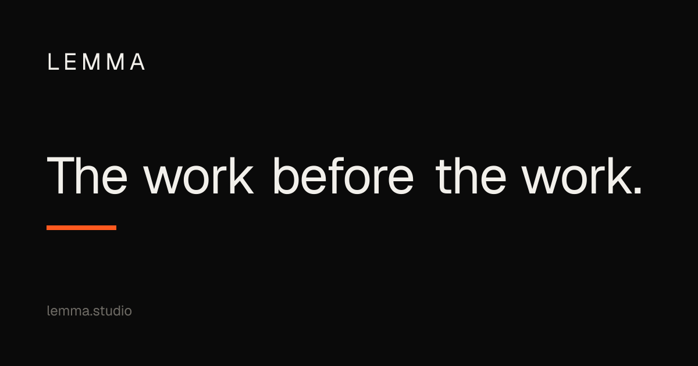

<div align="center">


<br><br>

# Lemma Website

[Website](https://lemma.studio) &nbsp;&middot;&nbsp; [Instagram](https://www.instagram.com/lemma.bercerita/) &nbsp;&middot;&nbsp; [LinkedIn](https://www.linkedin.com/company/lemma-bercerita/) &nbsp;&middot;&nbsp; [Threads](https://www.threads.com/@lemma.bercerita)


</div>

## About

Lemma (PT Masih Dilemma Makna) is a venture studio in Jakarta. This repository is its landing page, built with [Next.js](https://nextjs.org) (App Router), [React](https://react.dev), [TypeScript](https://www.typescriptlang.org), [Tailwind CSS](https://tailwindcss.com), [GSAP](https://gsap.com) and [Lenis](https://lenis.darkroom.engineering).

- **Bilingual Copy**: Indonesian and English text, switched on the client and remembered in a `NEXT_LOCALE` cookie. Shared and home copy lives in `lib/messages.ts`, section copy in `lib/about.ts`, `lib/services.ts`, `lib/work.ts` and `lib/contact.ts`.
- **Dark and Light Theme**: Dark by default. The choice is stored in `localStorage` under `lemma-theme` and applied before first paint.
- **Motion**: [GSAP](https://gsap.com) animations with [Lenis](https://lenis.darkroom.engineering) smooth scroll and page transitions.
- **Typed Environment**: Site settings are read and validated in one module, `lib/env.ts`.
- **SEO**: Per-page metadata and canonical URLs, sitemap, robots, Open Graph and Twitter images, JSON-LD, and `llms.txt` routes, all built on [Next.js](https://nextjs.org) metadata routes.
- **Contact API**: A same-origin JSON endpoint with a per-IP rate limit, a honeypot and a fill-time check. Messages go to an optional webhook, or the form falls back to a `mailto:` link.
- **Design Tokens**: Colors, type scale, radius and easing are CSS custom properties mapped into [Tailwind CSS](https://tailwindcss.com) 4 `@theme`.
- **Lighthouse Runner**: `scripts/lighthouse.sh` builds, starts and audits five pages on mobile and desktop. Results are recorded in `docs/lighthouse/`.

## Getting Started

```bash
npm install
npm run dev
```

Open [http://localhost:3000](http://localhost:3000). See [Prerequisites](#prerequisites) and [Installation](#installation) for bun and other setup details, and [Scripts](#scripts) for every command.

## Prerequisites

- **Node.js 20.9 or newer**: the minimum for Next.js 16.4.2, as stated in the docs bundled in `node_modules/next/dist/docs/`. The project has no `.nvmrc` or `engines` field.
- **npm** (ships with Node.js) or **bun**.
- **Git**, only for the optional [Local Git Hook](#local-git-hook).

## Installation

Install dependencies with npm:

```bash
npm install
```

or with bun:

```bash
bun install
```

Both lockfiles are committed: `package-lock.json` for npm and `bun.lock` for bun.

## Environment Variables

Copy `.env.example` to `.env.local` for local development. `.env.local` is git-ignored. All three variables are optional.

| Variable                   | Purpose                                                                                                                              |
| -------------------------- | ------------------------------------------------------------------------------------------------------------------------------------ |
| `NEXT_PUBLIC_SITE_URL`     | Production origin for canonical URLs, sitemap, JSON-LD and `/llms.txt`. Defaults to `https://lemma.studio`. Must be an absolute URL. |
| `GOOGLE_SITE_VERIFICATION` | Token from Google Search Console ("HTML tag" method). Leave empty to skip.                                                           |
| `CONTACT_WEBHOOK_URL`      | Webhook that receives contact form submissions. Server-only, never sent to the browser.                                              |

Production values are set in Vercel. Contact form behavior, including the `mailto:` fallback, is described in [Deploy (Vercel)](#deploy-vercel).

## Development

```bash
npm run dev          # Start the development server on http://localhost:3000
npm run typecheck    # Type-check with tsc --noEmit
npm run lint         # Lint with oxlint
npm run lint:fix     # Lint and apply oxlint fixes
npm run format       # Format with oxfmt
npm run format:check # Check formatting without writing files
npm run analyze      # Analyze the production bundle with next analyze
```

Replace `npm run` with `bun run` to use bun.

## Local Git Hook

The pre-commit hook in `.githooks/pre-commit` is opt-in. Enable it once per clone:

```bash
git config core.hooksPath .githooks
```

It checks the staged files in this order:

1. `oxfmt --check` on staged `ts`, `tsx`, `js`, `mjs`, `css`, `json` and `md` files. Advisory: it prints unformatted files and never blocks the commit.
2. `oxlint` on staged `ts`, `tsx`, `js` and `mjs` files. Blocks the commit on errors only. Warnings pass.
3. `npm run typecheck`. Blocks the commit on failure.

Disable the hook with:

```bash
git config --unset core.hooksPath
```

## Mobile Testing

Start the development server on all network interfaces:

```bash
npx next dev -H 0.0.0.0
```

Find your computer's LAN IP (on macOS: `ipconfig getifaddr en0`), then open `http://<LAN-IP>:3000` on a phone on the same network.

To test without a phone, use the device toolbar in Chrome DevTools at 360x640 and 390x844.

## Scripts

| Command                | What it does                                          |
| ---------------------- | ----------------------------------------------------- |
| `npm run dev`          | Start the development server on http://localhost:3000 |
| `npm run build`        | Create a production build                             |
| `npm run start`        | Serve the production build                            |
| `npm run lint`         | Lint with oxlint                                      |
| `npm run lint:fix`     | Lint and apply oxlint fixes                           |
| `npm run typecheck`    | Type-check with `tsc --noEmit`                        |
| `npm run format`       | Format with oxfmt                                     |
| `npm run format:check` | Check formatting without writing files                |
| `npm run analyze`      | Analyze the production bundle with `next analyze`     |

Standalone scripts in `scripts/`:

- `node scripts/optimize-work-photos.mjs` converts work photos to WebP. See [Work Photos](#work-photos).
- `node scripts/dither-photos.mjs` writes the two-tone dithered art to `public/dithered/` (Bayer 4x4 ordered dither, lossless WebP). It overwrites the files on each run and exits with status 1 if any file is larger than 30 KB.
- `scripts/lighthouse.sh` builds and starts the app on port 3100 (set `PORT` to change it), audits five pages on mobile and desktop, writes the raw JSON to `docs/lighthouse/raw/` (git-ignored) and prints a score table.

## Deploy (Vercel)

Set these in Vercel under Project → Settings → Environment Variables:

| Variable                   | Purpose                                                                                                                                         |
| -------------------------- | ----------------------------------------------------------------------------------------------------------------------------------------------- |
| `NEXT_PUBLIC_SITE_URL`     | Production origin used for canonical URLs, sitemap, JSON-LD and `/llms.txt` (default `https://lemma.studio`).                                   |
| `GOOGLE_SITE_VERIFICATION` | Token from Google Search Console ("HTML tag" method). Rendered as `<meta name="google-site-verification">`.                                     |
| `CONTACT_WEBHOOK_URL`      | Where the contact form is forwarded (e.g. a Make, Zapier, n8n or Formspree webhook that emails you). Server-only; never exposed to the browser. |

Without `CONTACT_WEBHOOK_URL` the form does not lose messages. It shows a pre-filled `mailto:` link instead.

The contact API accepts same-origin JSON only, rate-limits requests per IP, and silently drops bot submissions (honeypot and fill-time check).

## Work Photos

Put raw PNG/JPG files in `public/work-photos/<project-slug>/`, then run `node scripts/optimize-work-photos.mjs`. The script converts them to WebP, deletes the originals and regenerates `lib/work-photos.ts`.

## Project Structure

- `app/` - routes (one `page.tsx` per page), `layout.tsx`, `sitemap.ts`, `robots.ts`, `manifest.ts`, OG and Twitter images, `llms` and `index.md` routes, and `api/contact/`
- `app/styles/tokens.css` - design tokens; `app/globals.css` - global styles; `app/fonts.ts` - fonts
- `components/home/`, `components/about/`, `components/services/`, `components/work/`, `components/contact/` - sections for each page
- `components/nav/` - floating nav pill
- `components/ui/` - shared pieces such as `Button.tsx`, `ContactForm.tsx` and `Cursor.tsx`
- `components/` - app-wide wrappers such as `Providers.tsx`, `LocaleProvider.tsx` and `JsonLd.tsx`
- `lib/` - non-visual code: `env.ts` (typed env), `messages.ts` (shared and home copy, ID and EN), `site.ts` (metadata and JSON-LD), GSAP, Lenis and intro setup, and `work-photos.ts`
- `public/` - logo, service images, `work-photos/` and `dithered/`
- `scripts/` - photo, dither and Lighthouse scripts
- `docs/` - architecture, contributing, best practices and Lighthouse reports
- `.githooks/` - optional pre-commit hook

See [ARCHITECTURE.md](docs/ARCHITECTURE.md) for the layers and folder rules.

## Architecture and Design Tokens

Routes live in `app/`, feature components in `components/<feature>/`, and non-visual code (configuration, text, data, helpers) in `lib/`. Dependencies point one way: components depend on `lib/`, and `lib/` never imports from `components/`. The full rules are in [ARCHITECTURE.md](docs/ARCHITECTURE.md).

Design tokens are defined only in `app/styles/tokens.css`. The layer utilities `z-grain`, `z-overlay`, `z-modal`, `z-transition`, `z-preloader` and `z-cursor` map to `--z-index-*` tokens. The type scale is used through `text-ds-*` utilities (`--text-ds-xs` to `--text-ds-2xl`), because the bare `--text-xs` to `--text-2xl` names collide with Tailwind defaults. Components use these utilities or `var(--name)` instead of new color values or numeric z-index values.

## Content and Design

- Copy source: `.copywriting/lemma_home_copywriting.md`. Keep text in `lib/` (shared and home copy in `lib/messages.ts`, section copy in `lib/about.ts`, `lib/contact.ts`, `lib/services.ts` and `lib/work.ts`) and do not hardcode strings in components.
- Design brief: `.agents/DESIGN.md`. Dark by default with a light theme override, one orange accent, mono labels.
- Public pages must not show the full name or technical details of the ARAH product.

## Performance, SEO and Lighthouse

Scores are from [after-art.md](docs/lighthouse/after-art.md), a lab run on 2026-10-23 with `scripts/lighthouse.sh` (one run per page, fresh profile). They are not 100 on every page.

| Page               | Performance | Accessibility | Best Practices | SEO | LCP   |
| ------------------ | ----------- | ------------- | -------------- | --- | ----- |
| Home (mobile)      | 86          | 100           | 100            | 100 | 4.18s |
| About (mobile)     | 88          | 96            | 100            | 100 | 3.80s |
| Services (mobile)  | 87          | 96            | 100            | 100 | 3.85s |
| Work (mobile)      | 85          | 92            | 100            | 100 | 4.26s |
| Contact (mobile)   | 92          | 96            | 100            | 100 | 3.41s |
| Home (desktop)     | 98          | 100           | 100            | 100 | 1.03s |
| About (desktop)    | 100         | 100           | 100            | 100 | 0.80s |
| Services (desktop) | 99          | 96            | 100            | 100 | 0.82s |
| Work (desktop)     | 99          | 96            | 100            | 100 | 0.99s |
| Contact (desktop)  | 99          | 96            | 100            | 100 | 0.82s |

Best Practices and SEO are 100 on all 10 pages. Accessibility is 100 on 3 pages and 92 to 96 on the rest. Performance is 100 on About (desktop), 98 to 99 on the other desktop pages and 85 to 92 on mobile. CLS is 0.000 on all pages.

Mobile LCP is the gap: 3.41s to 4.26s against 0.80s to 1.03s on desktop. The LCP copy stays hidden until hydration and the intro fade finish, which accounts for most of the mobile render delay (about 2 s in the audit data, not measured in a trace). See [fixes.md](docs/lighthouse/fixes.md) for the LCP elements and [after-perf.md](docs/lighthouse/after-perf.md) for the open audits.

### SEO

- **Metadata**: `pageMeta()` in `lib/site.ts` sets the title, description and Open Graph data for each page route.
- **Canonical URLs**: `alternates.canonical` in `pageMeta()` and in the root layout.
- **Sitemap**: `app/sitemap.ts`, served at `/sitemap.xml`.
- **Robots**: `app/robots.ts`, which allows `/`, disallows `/api/` and points to the sitemap.
- **Manifest**: `app/manifest.ts`.
- **Open Graph and Twitter images**: `app/opengraph-image.tsx` and `app/twitter-image.tsx`.
- **JSON-LD**: `siteJsonLd` and `pageJsonLd` in `lib/site.ts`, rendered by `components/JsonLd.tsx`.
- **LLM routes**: `app/llms.txt/route.ts` and `app/llms-full.txt/route.ts`.
- **Markdown index**: `app/index.md/route.ts`, with the same content as `llms-full.txt`.

## Best Practices

[docs/BEST_PRACTICES.md](docs/BEST_PRACTICES.md) is a checklist of speed, SEO and developer experience practices, each with its status and code location.

Sourcing: only the static rendering of content sites, the SEO and accessibility deep dive and the layered architecture points come from the [GreatFrontEnd front-end system design playbook](https://www.greatfrontend.com/front-end-system-design-playbook/framework). The rest is standard practice that is not verified against GreatFrontEnd.

---

## Tech Stack

- **Framework and Core**: [Next.js](https://nextjs.org) 16 (App Router), [React](https://react.dev) 19 (`react` and `react-dom`), and [TypeScript](https://www.typescriptlang.org) 5
- **Styling**: [Tailwind CSS](https://tailwindcss.com) 4, with `@tailwindcss/turbopack`
- **Motion**: [GSAP](https://gsap.com) with [@gsap/react](https://www.npmjs.com/package/@gsap/react), and [Lenis](https://lenis.darkroom.engineering) for smooth scroll
- **Tooling**: [oxlint](https://oxc.rs) and [oxfmt](https://oxc.rs) from the oxc project, [sharp](https://sharp.pixelplumbing.com) for image processing, and [npm](https://www.npmjs.com) or [bun](https://bun.sh) as package managers
- **Deployment**: [Vercel](https://vercel.com)

## Contributing

Read [CONTRIBUTING.md](docs/CONTRIBUTING.md) before you open a change. It covers branch names, the quality gate and the oxc tooling.

Commit messages follow conventional commits in the form `type(scope): summary`, on one line, for example `docs(readme): add tech stack`. The convention is documented, not enforced: the repository runs no commitlint or other message check.

<div align="center">

<sub>Copyright &copy; 2026 PT Masih Dilemma Makna. All rights reserved.</sub>

</div>
